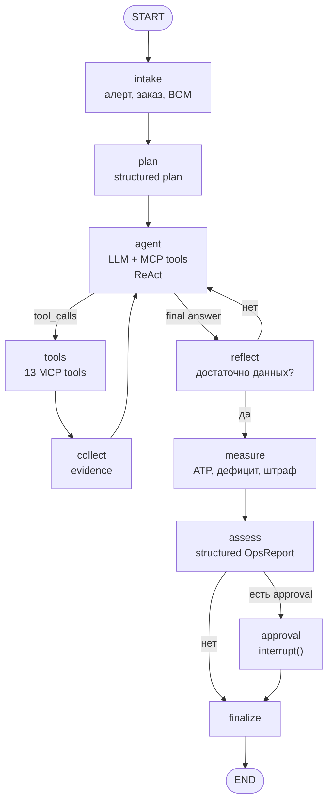
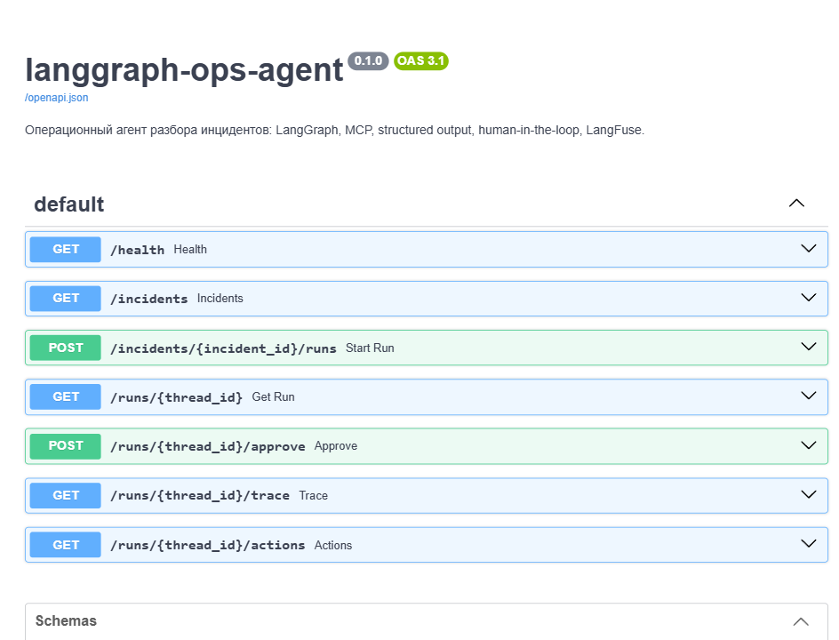
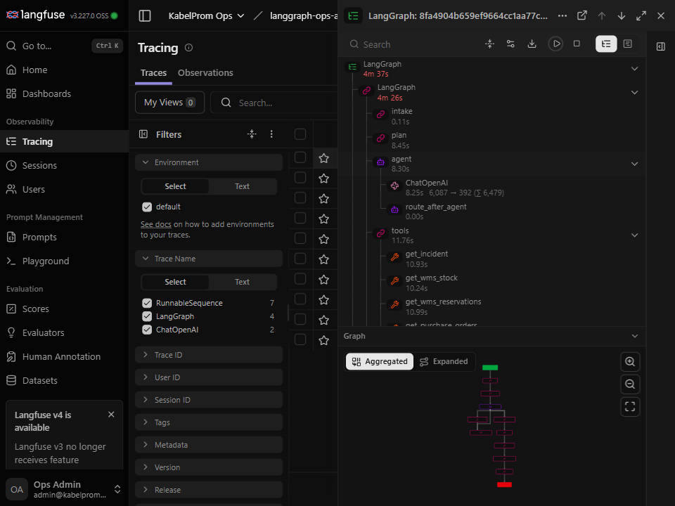

# langgraph-ops-agent

**Операционный агент, который разбирает производственный инцидент по данным пяти систем и доводит решение до согласования.**

[](https://github.com/Nikita-Kotlyar/langgraph-ops-agent/actions/workflows/ci.yml)
[](https://www.python.org/)
[](https://langchain-ai.github.io/langgraph/)
[](https://modelcontextprotocol.io/)
[](https://fastapi.tiangolo.com/)
[](https://docs.docker.com/compose/)
[](#тесты)
[](LICENSE)

> Данные обезличены в соответствии с требованиями NDA. Названия контрагентов,
> артикулы и суммы заменены производными значениями; структура процессов и
> форматы интеграции сохранены.

---

## Содержание

- [Проблема](#проблема)
- [Решение](#решение)
- [Архитектура](#архитектура)
- [Стек](#стек)
- [Развёртывание](#развёртывание)
- [API](#api)
- [MCP](#mcp)
- [Наблюдаемость](#наблюдаемость)
- [Docker](#docker)
- [Результаты](#результаты)
- [Структура](#структура)
- [Тесты](#тесты)
- [Эксплуатационные границы](#эксплуатационные-границы)
- [Развитие](#развитие)
- [Лицензия](#лицензия)

---

## Проблема

На кабельном производстве остановлена линия `MC-044`. В MES — причина
`MATERIAL_WAIT`. Под угрозой заказ `ORD-2026-01201` на **4 665 090 ₽**
с отгрузкой 13.11.2026.

При этом WMS показывает **2 400 кг** медной проволоки. Первый поверхностный
вывод — «материал есть, проблема в MES». Он неверный.

| Слой | Значение | Что это значит |
|---|---:|---|
| Брутто-остаток WMS | 2 400 кг | выглядит достаточно |
| Резерв под `ORD-2026-01202` | 1 650 кг | материал уже обещан другому заказу |
| Карантин качества | 250 кг | партия ждёт решения ОТК |
| Страховой запас | 300 кг | неприкосновенный минимум |
| **ATP** | **200 кг** | реально свободно |
| Потребность заказа | **1 701,212 кг** | 4 000 м 5×6 + 2 500 м 7×1,5 + 2 000 м 3×6 |
| **Дефицит** | **1 501,212 кг** | причина остановки |

Параллельно заявка `PO-2026-11-0142` на 2 000 кг **заблокирована** из-за
расхождения цены: счёт 672 ₽/кг против договорных 640 ₽/кг (+5%). Счёт не
оплачен. Поставщик подтверждает только 60% (1 200 кг) 10.11, остаток 800 кг —
12.11.

Без действий: материал 12.11 → производство 2 дня + ОТК 1 день → готовность
15.11 → просрочка 2 дня, штраф **27 990,54 ₽**.

### Почему это не решается обычным скриптом

Ответ собирается из пяти систем и двух документов, а данные противоречат
друг другу:

- MES говорит «линия стоит»;
- WMS говорит «остаток есть»;
- 1С говорит «заявка заблокирована»;
- почта говорит «поставщик даст только 60%»;
- CRM говорит «клиент стратегический, штраф 0,3% в день»;
- регламент говорит, как считать ATP и кто утверждает перераспределение;
- договор говорит, как считать неустойку.

Скрипт с фиксированным маршрутом ломается на первом противоречии. Нужен агент,
который сам выбирает, что проверить, замечает пробелы и возвращается за данными.

---

## Решение

Агент проходит путь от алерта до согласованного плана:

1. читает алерт, заказ, BOM и данные донора;
2. строит план расследования;
3. вызывает MCP-инструменты и собирает доказательства;
4. проверяет полноту и при необходимости возвращается за данными;
5. считает ATP, дефицит, даты и штраф детерминированным узлом `measure`;
6. формирует структурированный `OpsReport`;
7. останавливается на `approval`, если действие меняет резерв, тратит деньги
   или меняет срок клиенту;
8. фиксирует отчёт, аудит действий и трейс.

Результат прогона:

```json
{
  "root_cause_code": "ATP_MISMATCH_AND_BLOCKED_PO",
  "impact": {
    "copper_need_kg": 1701.212,
    "available_kg": 200.0,
    "deficit_kg": 1501.212,
    "days_late_without_action": 2,
    "penalty_rub": 27990.54
  },
  "recommended_actions": [
    "reallocate_reserved_copper",
    "approve_price_variance_and_pay",
    "expedite_alternative_supplier",
    "notify_customer"
  ],
  "confidence": 0.85
}
```

---

## Архитектура



| Узел | Задача |
|---|---|
| `intake` | читает алерт, заказ, BOM, донора; формулирует цель |
| `plan` | LLM строит `InvestigationPlan`: вопросы, инструменты, критерий полноты |
| `agent` | ReAct-шаг: думает, вызывает инструменты или даёт финальный ответ |
| `tools` | `ToolNode` исполняет tool calls |
| `collect` | превращает `ToolMessage` в `Evidence` со ссылками на источник |
| `reflect` | проверяет шесть пунктов: причина, ATP, дефицит, влияние, донор, регламент |
| `measure` | детерминированно считает need, ATP, deficit, delivery risk, penalty, donor risk |
| `assess` | LLM формирует `OpsReport`; policy нормализует роли согласующих |
| `approval` | `interrupt()` — пауза до решения человека |
| `finalize` | пишет `report.json`, `actions.jsonl`, `state.json`, трейс и делает `flush()` LangFuse |

Подробно: [`docs/ARCHITECTURE.md`](docs/ARCHITECTURE.md).

Ключевое решение: **LLM выбирает, что проверить, а `measure` считает числа.**
Модель не выдумывает ATP и штраф — она получает их из read-only инструментов
и передаёт в structured-отчёт.

---

## Стек

| Технология | Где применена |
|---|---|
| **LangGraph** | `StateGraph`, 10 узлов, conditional edges, `AsyncSqliteSaver`, `interrupt()` |
| **LangChain** | `ChatOpenAI` (RouterAI), messages, tools, callbacks, `with_structured_output` |
| **tool / function calling** | `bind_tools`, `ToolNode`, 13 MCP-инструментов |
| **ReAct** | явный цикл `agent → tools → collect → agent → reflect` |
| **AI-агент** | планирование, выбор инструментов, рефлексия, отчёт, HITL |
| **MCP** | `FastMCP`-сервер + `MultiServerMCPClient` stdio |
| **structured output** | Pydantic-схемы + `with_structured_output(method="function_calling")` |
| **LangFuse** | `Langfuse` client + `CallbackHandler`, один трейс на запуск |
| **FastAPI** | `/health`, `/incidents`, `/runs`, `/approve`, `/trace`, `/actions` |
| **Docker** | API + MCP в одном образе, compose, healthcheck |
| **RouterAI** | `https://routerai.ru/api/v1`, `anthropic/claude-haiku-4.5` |
| **pytest** | 22 теста, включая реальный MCP stdio |

---

## Развёртывание

### 1. Установка

```bash
git clone https://github.com/Nikita-Kotlyar/langgraph-ops-agent.git
cd langgraph-ops-agent
uv sync --extra dev
cp .env.example .env
```

### 2. Модель

Проект настроен на **RouterAI** — OpenAI-совместимый шлюз к Anthropic, OpenAI,
DeepSeek, Qwen и другим моделям ([docs.routerai.ru](https://routerai.ru/docs/guides)).

```env
OPS_LLM_PROVIDER=openai
OPS_LLM_MODEL=anthropic/claude-haiku-4.5
OPS_LLM_BASE_URL=https://routerai.ru/api/v1
OPS_LLM_API_KEY=sk-...
```

Ключ можно не дублировать: если он лежит в переменной окружения
`ROUTERAI_API_KEY`, `Settings` подхватит её автоматически. Любая другая модель
RouterAI (`deepseek/deepseek-v4.1-flash-1017`, `openai/gpt-4o-mini`,
`qwen/qwen3.5-plus` и т.д.) задаётся через `OPS_LLM_MODEL`.

Альтернативы:

```env
# Anthropic напрямую или через корпоративный LLM-gateway
OPS_LLM_PROVIDER=anthropic
OPS_LLM_MODEL=claude-haiku-4-5-20251001
OPS_LLM_BASE_URL=https://llm.example.com/v1

# OpenAI
OPS_LLM_PROVIDER=openai
OPS_LLM_MODEL=gpt-4o-mini
OPS_LLM_BASE_URL=https://api.openai.com/v1
OPS_LLM_API_KEY=...
```

### 3. Проверить MCP-инструменты

```bash
uv run ops-agent tools
```

Должно быть 13 инструментов: `get_incident`, `get_order`, `get_bom`,
`get_wms_stock`, `get_wms_reservations`, `get_mes_status`,
`get_purchase_orders`, `get_customer`, `search_emails`,
`search_documents`, `calculate_material_gap`, `calculate_penalty`,
`calculate_delivery_risk`.

### 4. Запустить разбор

```bash
uv run ops-agent run --incident INC-2026-11-06-01 --approve
```

`--approve` — подтверждение оператора для сквозного сценария.
Без флага агент остановится и покажет запрос на согласование.

### 5. Проверить отчёт по эталону

Отчёт сохраняется в `runs/{thread_id}/report.json`:

```bash
uv run python tools/check.py runs/<thread_id>/report.json
```

---

## API

```bash
uv run uvicorn app.api:app --host 0.0.0.0 --port 8095
```

В контуре предприятия API публикуется через ingress; базовый URL задаётся
в `OPS_PUBLIC_URL`. Swagger доступен по адресу
`https://ops-agent.kabelprom.example/docs`.



| Метод | Путь | Назначение |
|---|---|---|
| `GET` | `/health` | статус, модель, число MCP-инструментов |
| `GET` | `/incidents` | список инцидентов |
| `POST` | `/incidents/{id}/runs` | запуск; `202` и `approval_request`, если нужен человек |
| `GET` | `/runs/{thread_id}` | состояние и отчёт |
| `POST` | `/runs/{thread_id}/approve` | approve/reject и продолжение графа |
| `GET` | `/runs/{thread_id}/trace` | JSONL-трейс |
| `GET` | `/runs/{thread_id}/actions` | аудит действий |

```bash
export OPS_API_URL=https://ops-agent.kabelprom.example

# запуск
curl -X POST "$OPS_API_URL/incidents/INC-2026-11-06-01/runs"

# статус и approval_request
curl "$OPS_API_URL/runs/<thread_id>"

# подтверждение
curl -X POST "$OPS_API_URL/runs/<thread_id>/approve" \
  -H "Content-Type: application/json" \
  -d '{"approved": true, "comment": "ok", "approver": "director"}'

# трейс и аудит действий
curl "$OPS_API_URL/runs/<thread_id>/trace"
curl "$OPS_API_URL/runs/<thread_id>/actions"
```

---

## MCP

Сервер запускается отдельным процессом по stdio; агент получает схемы
инструментов динамически, без дублирования в коде.

```bash
uv run python -m app.mcp_server
```

| Инструмент | Вход | Что возвращает |
|---|---|---|
| `get_incident` | `incident_id` | алерт, README, индекс файлов |
| `get_order` | `order_id` | шапка и строки заказа |
| `get_bom` | `sku` | расход меди на км |
| `get_wms_stock` | `material_id` | брутто, резерв, карантин, страховой запас, ATP |
| `get_wms_reservations` | `material_id` | резервы по заказам |
| `get_mes_status` | `order_id` / `machine_id` | задания и события линии |
| `get_purchase_orders` | `material_id` | заявки, счета, котировки |
| `get_customer` | `customer_id` | клиент, договор, штрафы |
| `search_emails` | `query`, `limit` | письма с фрагментами |
| `search_documents` | `query`, `limit` | выдержки из договора/регламента |
| `calculate_material_gap` | `order_id`, `material_id` | потребность, ATP, дефицит |
| `calculate_penalty` | `order_id`, `days_late` | штраф по договору |
| `calculate_delivery_risk` | `order_id`, `material_arrival_date` | просрочка и штраф с учётом цикла 2 дня + ОТК |

Подключение к Claude Desktop / Cherry Studio:

```json
{
  "mcpServers": {
    "kabelprom-ops": {
      "command": "python",
      "args": ["-m", "app.mcp_server"],
      "cwd": "/opt/langgraph-ops-agent",
      "env": {
        "OPS_INCIDENT_DIR": "/opt/langgraph-ops-agent/data/incidents/INC-2026-11-06-01",
        "OPS_ENTERPRISE_DIR": "/opt/langgraph-ops-agent/data"
      }
    }
  }
}
```

Инструменты только читают данные. Никакого SQL, shell, HTTP и записи.

---

## Наблюдаемость

Если заданы ключи, `CallbackHandler` трассирует plan, LLM-вызовы, tool calls,
reflect, assess и approval:

```env
LANGFUSE_PUBLIC_KEY=pk-lf-...
LANGFUSE_SECRET_KEY=sk-lf-...
LANGFUSE_HOST=https://langfuse.example.com
```

Без ключей работает JSONL-трейс: `runs/{thread_id}/trace.jsonl` с узлами,
длительностями и tool calls.

LangFuse развёрнут в контуре предприятия. UI доступен по адресу
`https://langfuse.example.com`; адрес задаётся через `LANGFUSE_HOST`.



---

## Docker

```bash
cp .env.example .env
docker compose up -d --build
```

API публикуется через ingress. Compose монтирует `data` в `/data:ro`
и `runs/` в `/app/runs`; healthcheck проверяет `/health` внутри контейнера.

```bash
docker compose down
```

---

## Результаты

| Проверка | Результат |
|---|---|
| `pytest` | **22 passed** |
| `ruff check app tests` | **All checks passed** |
| Docker health | `status=ok`, `tools=13`, `langfuse=true` |
| Модель | `anthropic/claude-haiku-4.5` |
| Golden-check `15` | **OK** |
| Docker API | `POST /runs` → `202` + approval, `POST /approve` → `200` + completed |
| LangFuse | трейс `LangGraph`: **116 наблюдений**, 277 с |

Роли согласующих нормализуются политикой:

| Действие | Approval | Роль |
|---|---|---|
| `reallocate_reserved_copper` | да | `operations_director` |
| `approve_price_variance_and_pay` | да | `procurement_head` |
| `expedite_alternative_supplier` | да | `finance_director` |
| `notify_customer` | нет | — |

---

## Структура

```text
langgraph-ops-agent/
├── app/
│   ├── api.py            # FastAPI: runs, approvals, trace, actions
│   ├── graph.py          # StateGraph, nodes, ReAct, HITL
│   ├── state.py          # AgentState
│   ├── models.py         # Pydantic: plan, reflection, OpsReport
│   ├── policy.py         # роли согласующих по регламенту
│   ├── prompts.py        # системные и узловые промпты
│   ├── enterprise.py     # read-only доступ к данным
│   ├── mcp_server.py     # FastMCP server, 13 tools
│   ├── mcp_client.py     # stdio-подключение и загрузка tools
│   ├── llm.py            # RouterAI/Anthropic/OpenAI factory, LangFuse
│   ├── checkpoint.py     # AsyncSqliteSaver + whitelist моделей
│   ├── tracing.py        # JSONL-трейс
│   └── cli.py            # ops-agent run/tools/serve
├── data/                 # инцидент и эталон
├── docs/                 # архитектура, скриншоты
├── tools/check.py        # сверка отчёта с эталоном
├── tests/
├── Dockerfile
├── docker-compose.yml
└── .github/workflows/ci.yml
```

---

## Тесты

```bash
uv run pytest -m "not mcp"     # 20 unit/API/graph/policy/golden
uv run pytest                  # 22, включая реальный MCP stdio
uv run ruff check app tests
```

| Файл | Что проверяет |
|---|---|
| `tests/test_tools.py` | ATP, дефицит, штраф, поиск писем и документов |
| `tests/test_mcp.py` | MCP-сервер поднимается, отдаёт 13 инструментов |
| `tests/test_graph.py` | plan → tools → reflect → measure → assess → approval |
| `tests/test_api.py` | запуск, `202`, approval, resume, 404 |
| `tests/test_policy.py` | роли согласующих по регламенту |
| `tests/test_golden_incident.py` | числа и действия против эталона |

---

## Эксплуатационные границы

- Доступ к 1С, CRM, MES и WMS — read-only. Запись выполняется только через
  согласованные операции и фиксируется в аудите.
- MCP-сервер работает в периметре предприятия; аутентификация и роли —
  на уровне API-gateway.
- LangFuse развёрнут в контуре предприятия; адрес и ключи задаются через
  `LANGFUSE_HOST`, `LANGFUSE_PUBLIC_KEY`, `LANGFUSE_SECRET_KEY`.
- Модель доступа: RouterAI или собственный LLM-gateway; ключи хранятся
  в секрет-хранилище и не попадают в репозиторий.
- Данные обезличены; названия контрагентов и артикулы заменены.

---

## Развитие

- evals: golden dataset, LLM-as-judge, CI-гейт по `OpsReport`;
- Prometheus/OpenTelemetry для API и MCP;
- дополнительные коннекторы к производственным системам;
- расширение сценариев: претензии, качество, закупки.

---

## Лицензия

MIT. См. [LICENSE](LICENSE).

---

**Автор:** Никита Котляр · [GitHub](https://github.com/Nikita-Kotlyar)
