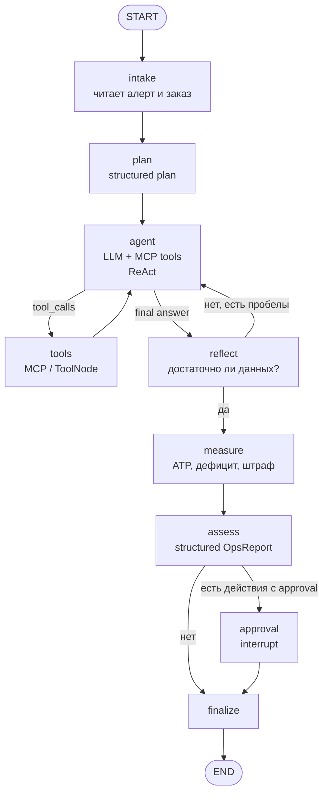

# Архитектура `langgraph-ops-agent`

## 1. Назначение

Агент разбирает производственные инциденты на кабельном производстве.
Первый сценарий — `INC-2026-11-06-01`: линия `MC-044` остановлена, заказ
`ORD-2026-01201` на 4,67 млн ₽ под угрозой, в WMS лежит 2,4 т меди, но
свободного остатка нет.

Задача агента — не «пересказать алерт», а собрать картину из пяти систем,
посчитать дефицит и цену риска, предложить действия и остановиться там, где
нужно решение человека.

## 2. Почему агент, а не скрипт

| Скрипт | Агент |
|---|---|
| Знает фиксированный маршрут | Сам выбирает инструменты под гипотезу |
| Падает на противоречии | Замечает противоречие и добирает данные |
| Не объясняет | Возвращает evidence со ссылками |
| Не имеет полномочий | Явно разделяет «предложить» и «выполнить» |

При этом агент не получает права менять данные: все инструменты read-only,
а действия выполняются только после approval.

## 3. Граф



### Узлы

| Узел | Что делает | Выход |
|---|---|---|
| `intake` | Читает `alert.json`, заказ, донора, BOM; формулирует цель | `objective`, `incident` |
| `plan` | LLM строит план: какие вопросы закрыть, какие инструменты вызвать | `InvestigationPlan` |
| `agent` | ReAct-шаг: reasoning + tool calling или финальный ответ | `AIMessage` |
| `tools` | Исполняет tool calls через `ToolNode`, пишет evidence | `ToolMessage[]`, `Evidence[]` |
| `reflect` | Проверяет полноту: причина, цифры, источники, противоречия | `Reflection` |
| `measure` | Детерминированно считает ATP, дефицит, даты и штраф | `computed` |
| `assess` | Формирует итоговый структурированный отчёт | `OpsReport` |
| `approval` | `interrupt()` — пауза до решения человека | `ApprovalDecision` |
| `finalize` | Фиксирует отчёт, действия и аудит в `runs/` | run record |

### Условные переходы

- `agent → tools`, если в ответе есть `tool_calls`; иначе `agent → reflect`.
- `reflect → agent`, если `sufficient=false` и `iterations < max_iterations`.
- `reflect → measure`, если данных достаточно.
- `measure → assess`: числа считает детерминированный код, не LLM.
- `assess → approval`, если хотя бы одно действие требует approval.
- `approval → finalize` после `Command(resume=...)`.

## 4. Состояние

```python
class AgentState(TypedDict):
    incident_id: str
    objective: str
    incident: dict
    plan: InvestigationPlan | None
    messages: Annotated[list[AnyMessage], add_messages]
    evidence: Annotated[list[Evidence], operator.add]
    reflection: Reflection | None
    computed: dict | None
    report: OpsReport | None
    approval: ApprovalRequest | None
    approval_decision: ApprovalDecision | None
    iterations: int
    tool_rounds: int
    max_iterations: int
    status: Literal["running", "awaiting_approval", "completed", "failed"]
    errors: Annotated[list[str], operator.add]
```

Состояние сохраняется в SQLite checkpointer. `thread_id` = `run_id`, поэтому
запуск можно продолжить после approval в другом HTTP-запросе.

## 5. Инструменты MCP

MCP-сервер `app.mcp_server` — отдельный процесс, транспорт `stdio`.
Агент подключается через `MultiServerMCPClient` и получает инструменты
динамически; в коде нет жёсткого списка tool-схем.

| Tool | Вход | Что возвращает |
|---|---|---|
| `get_incident` | `incident_id` | алерт, README, индекс файлов |
| `get_order` | `order_id` | шапка и строки заказа |
| `get_bom` | `sku` (optional) | расход меди на км |
| `get_wms_stock` | `material_id` | брутто, резерв, карантин, страховой запас, ATP |
| `get_wms_reservations` | `material_id` | резервы по заказам |
| `get_mes_status` | `order_id` / `machine_id` | задания, события линии |
| `get_purchase_orders` | `material_id` | заявки, счета, котировки |
| `get_customer` | `customer_id` | клиент, договор, штрафы |
| `search_emails` | `query`, `limit` | письма с релевантными фрагментами |
| `search_documents` | `query`, `limit` | выдержки из договора/регламента |
| `calculate_material_gap` | `order_id`, `material_id` | потребность, ATP, дефицит |
| `calculate_penalty` | `order_id`, `days_late` | штраф по договору |
| `calculate_delivery_risk` | `order_id`, `material_arrival_date` | просрочка и штраф с учётом цикла 2 дня + ОТК |

Инструменты только читают файлы. Никакого SQL, shell, HTTP и записи.

## 6. Structured output

Три Pydantic-модели:

1. `InvestigationPlan` — цель, вопросы, инструменты, критерий полноты.
2. `Reflection` — `sufficient`, `gaps`, `next_queries`, `confidence`.
3. `OpsReport` — причина, влияние, действия, evidence, unknowns, confidence.
   Числа берутся из `computed`, который заполняет узел `measure`.
4. `ApprovalDecision` — `approved`, `comment`, `approver`.

`OpsReport` — контракт для API и эталона `expected/15_ops_incident.json`.
Ключевые поля проверяются в `tools/check.py 15`.

## 7. Human-in-the-loop

Approval требуется, если действие:

- меняет резерв материала другого заказа;
- тратит деньги выше порога;
- меняет срок поставки клиенту.

`approval` вызывает `interrupt({...})`. Граф останавливается, API возвращает
`202` и `approval_request`. После `POST /runs/{thread_id}/approve` граф
продолжается через `Command(resume=decision)`.

После approval действие не выполняется «в CRM», а пишется в аудит-журнал
`runs/{thread_id}/actions.jsonl`. Запись во внешние системы выполняется только
через согласованные операции и фиксируется в аудите.

## 8. Наблюдаемость

- LLM: RouterAI (`https://routerai.ru/api/v1`, OpenAI-совместимый),
  модель `anthropic/claude-haiku-4.5`; ключ из `OPS_LLM_API_KEY` или `KEY`.
- LangFuse callback подключается к LLM и графу, если заданы
  `LANGFUSE_PUBLIC_KEY` и `LANGFUSE_SECRET_KEY`. Self-hosted compose:
  `LANGFUSE_HOST` в контуре предприятия.
- Трассируются: plan, каждый LLM-вызов, tool calls, reflect, assess, approval.
- Если внешний трейсинг недоступен, используется `runs/{thread_id}/trace.jsonl`:
  узлы, длительности, tool calls, ошибки.
- `trace_id` возвращается в API.

## 9. API

| Метод | Путь | Назначение |
|---|---|---|
| `GET` | `/health` | статус, версия, включён ли LangFuse |
| `GET` | `/incidents` | список инцидентов |
| `POST` | `/incidents/{id}/runs` | запуск агента |
| `GET` | `/runs/{thread_id}` | состояние и отчёт |
| `POST` | `/runs/{thread_id}/approve` | approve/reject и продолжение |
| `GET` | `/runs/{thread_id}/trace` | JSONL-трейс |
| `GET` | `/runs/{thread_id}/actions` | аудит действий |

## 10. Guardrails

- `max_iterations` (по умолчанию 6) и `max_tool_rounds` (12).
- Таймаут одного запуска (настраивается).
- Только whitelisted tools из MCP-сервера.
- Запрет на запись в исходные данные: `OPS_DATA_DIR` монтируется read-only.
- Валидация `OpsReport`: причина непустая, действия уникальны, evidence непустой.
- Ошибка инструмента не роняет граф: ToolMessage с ошибкой, счётчик errors.

## 11. Тесты

| Уровень | Что проверяет |
|---|---|
| `test_tools.py` | расчёты ATP, дефицита, штрафа, поиска |
| `test_mcp.py` | MCP-сервер поднимается и отдаёт инструменты |
| `test_graph.py` | маршрутизация plan → tools → reflect → assess → approval |
| `test_api.py` | запуск, 202 при approval, resume, 404 |
| `test_golden_incident.py` | ключевые поля отчёта против `expected/15_ops_incident.json` |
| `integration` | реальный LLM, помечен `@pytest.mark.integration` |

## 12. Docker

```text
docker compose up -d --build
api :8095 → контейнер :8000
volume ../../data:/data:ro
volume ./runs:/app/runs
```

MCP-сервер запускается внутри контейнера как дочерний процесс API через stdio.
LangFuse — внешний Cloud или self-hosted инстанс в контуре предприятия;
адрес задаётся через `LANGFUSE_HOST`.

## 13. Соответствие стеку

| Технология | Где используется |
|---|---|
| LangGraph | `StateGraph`, conditional edges, checkpointer, `interrupt` |
| LangChain | `ChatOpenAI` (RouterAI), messages, tools, callbacks |
| tool/function calling | `bind_tools`, `ToolNode`, MCP tools |
| ReAct | цикл `agent → tools → agent → reflect` |
| AI-агенты | автономный выбор инструментов и плана |
| MCP | `FastMCP` server + `MultiServerMCPClient` stdio |
| structured output | `with_structured_output` + Pydantic |
| LangFuse | `CallbackHandler`, traces, spans |
| FastAPI | API запуска, статуса и approvals |
| Docker | API + MCP в одном образе, compose, healthcheck |

## 14. Эксплуатационные границы

- Доступ к внешним системам — read-only; запись выполняется через согласованные
  операции и аудит.
- MCP-сервер работает в периметре предприятия; аутентификация и роли —
  на уровне API-gateway.
- LangFuse развёрнут в контуре предприятия; при недоступности внешнего
  трейсинга используется JSONL-трейс.
- Данные обезличены в соответствии с требованиями NDA.
- Детерминированность обеспечивается только в тестах с fake LLM; реальный
  ответ модели может отличаться формулировками.
